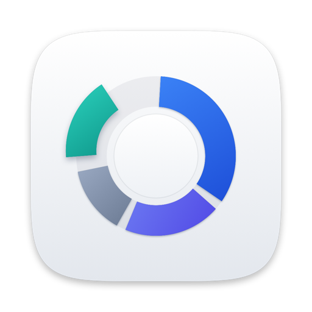
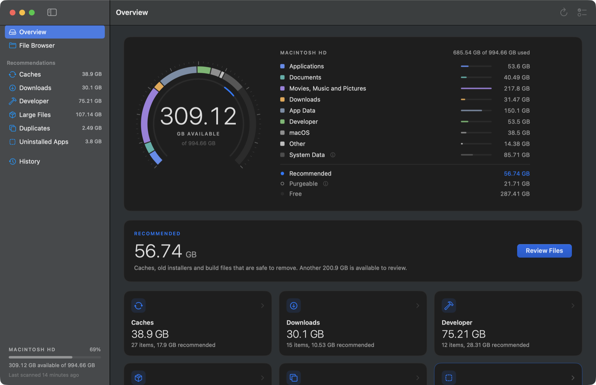
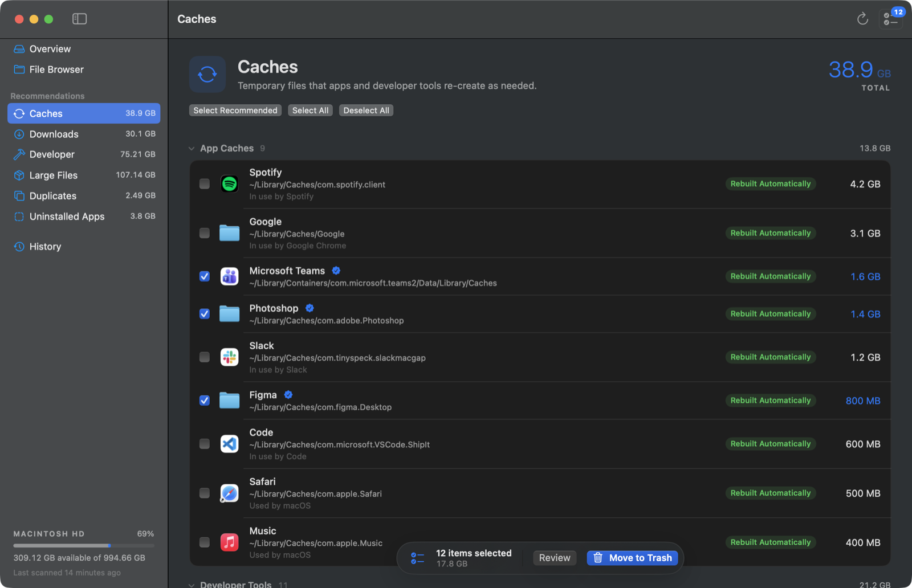
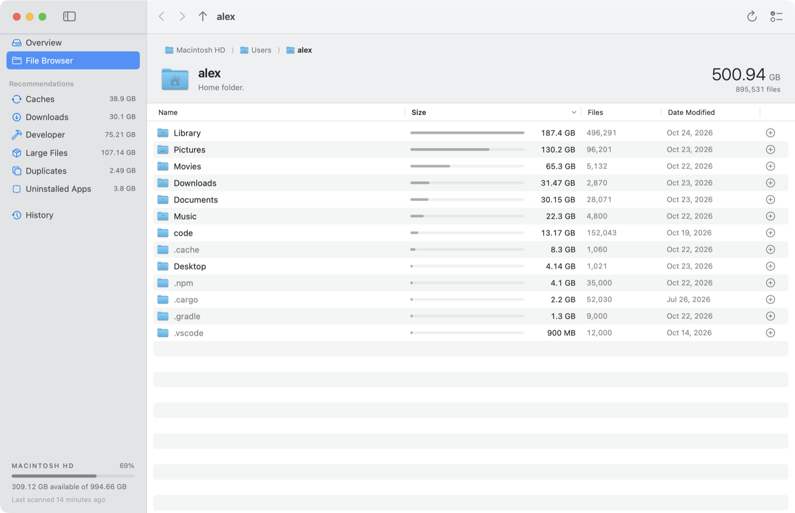
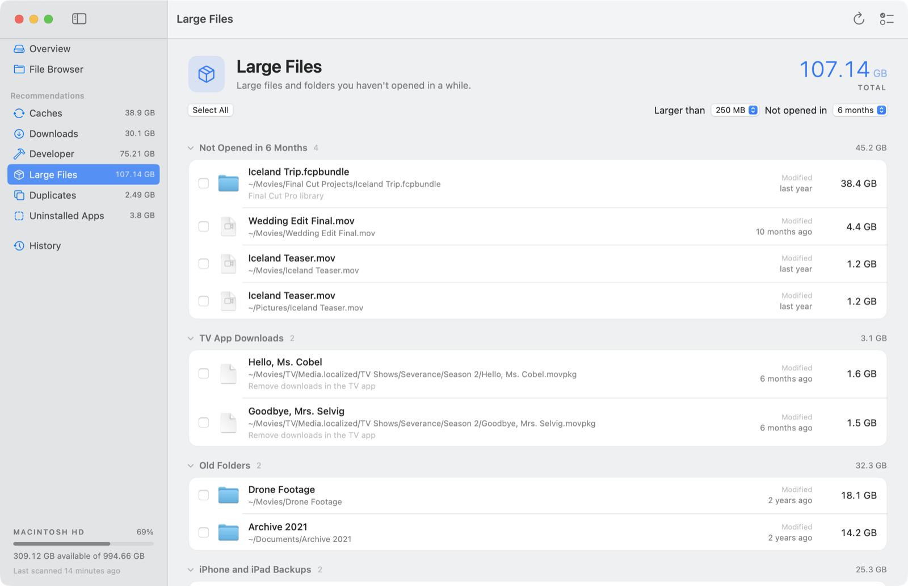
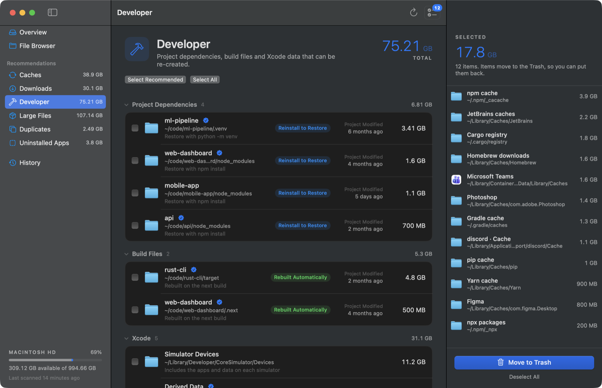
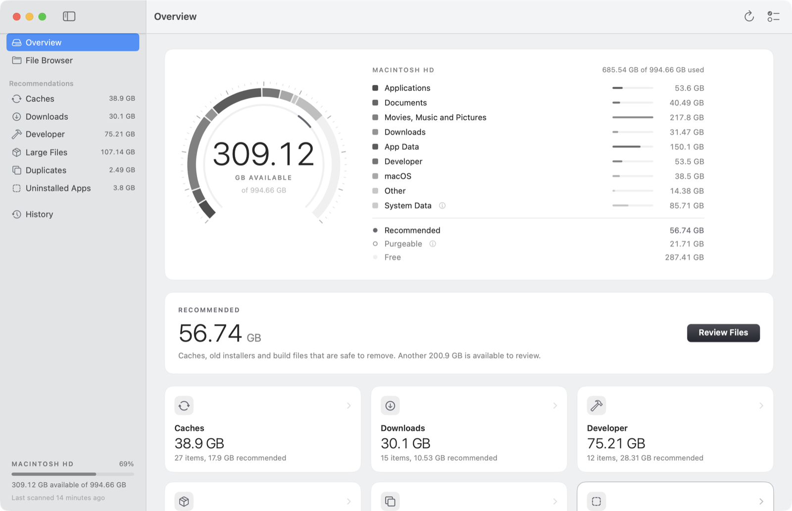
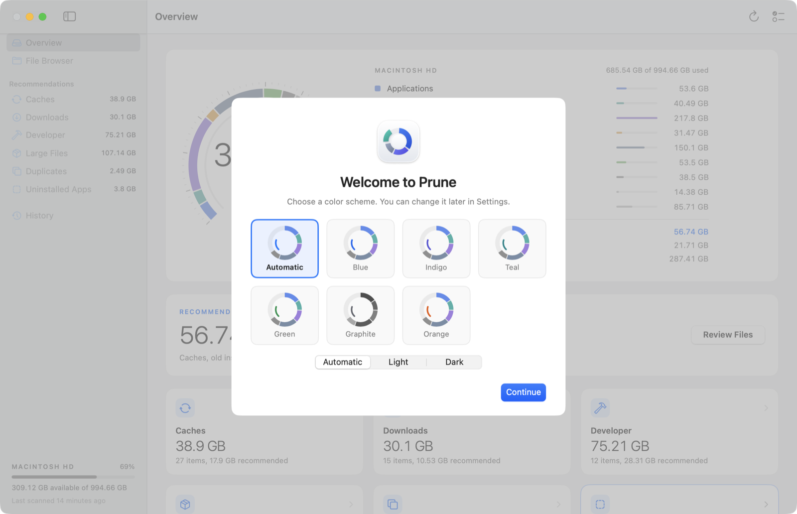

<p align="center">
  
</p>

<h1 align="center">Prune</h1>

<p align="center">A fast, native disk cleaner for macOS.<br>See what's using space, folder by folder, and clear what you don't need.</p>

<p align="center">
  <a href="../../releases/latest"><b>Download for Mac</b></a> ·
  <a href="docs/how-it-works.md">How it works</a> ·
  <a href="CHANGELOG.md">Changelog</a>
</p>



## Features

- **Scans your whole disk in under a minute.** Prune reads folders with `getattrlistbulk`, the fastest way to list a directory on APFS, across every core, and keeps the result so the app opens instantly next time.
- **Reports sizes you can trust.** Totals agree with `du` to within 0.01%. Hard links are counted once, savings account for APFS clones, and files kept only in iCloud aren't counted against your disk.
- **Recommendations for six kinds of clutter:** caches, old downloads, developer files (`node_modules`, virtual environments, Xcode data), large files you haven't opened in months, duplicate files, and support files from apps you've uninstalled.
- **A file browser sorted by size.** Click into any folder to see what's inside it, with Quick Look and Show in Finder.
- **Nothing is deleted outright.** Selected items go to the Trash, and History puts them back.
- **Honest free space.** Prune shows available space the way Finder does, explains space held by Time Machine snapshots, and can remove those snapshots when you need the room now.
- **Native and light.** A 3 MB SwiftUI app. No background process, no network access, no analytics.

## Install

1. Download **Prune-1.0.1.dmg** from the [latest release](../../releases/latest).
2. Open the disk image and drag **Prune** to **Applications**.
3. Open Prune. Because it isn't notarized by Apple, macOS blocks the first launch:
   open **System Settings > Privacy & Security**, scroll down, and click **Open Anyway** next to the message about Prune. You only do this once.
4. When Prune asks, allow **Full Disk Access** so it can measure everything, including Mail, Messages and other apps' data.
   Releases are signed without an Apple certificate, so after each update, turn Full Disk Access on for Prune again.

Requires a Mac with Apple silicon running macOS 15 Sequoia or later.

## Screenshots

| Recommendations | File Browser |
| --- | --- |
|  |  |
| **Large Files** | **Selection** |
|  |  |

Choose a color scheme on first launch, or later in **Settings > Appearance**. Automatic follows your Mac's accent color.

| Graphite, light | Welcome |
| --- | --- |
|  |  |

## How it decides what's safe

Each recommendation says why an item can go and what happens if you remove it:

| Label | Meaning |
| --- | --- |
| Safe to Remove | Not needed, such as installers you already used or incomplete downloads. |
| Rebuilt Automatically | A cache. The app or tool re-creates it as needed. |
| Reinstall to Restore | Project dependencies. Restore them with `npm install` or `python -m venv`. |
| *(no label)* | Your call: large files, duplicates and data from uninstalled apps are never selected for you. |

Prune refuses anything that would break macOS or an app, whatever you select: system folders, your home and Library folders themselves, keychains, files inside app bundles, and apps that ship with macOS. Caches belonging to apps that are open are left out of Recommended. [More detail](docs/how-it-works.md).

## Build from source

Prune needs only the Xcode Command Line Tools (`xcode-select --install`), not Xcode.

```bash
git clone https://github.com/benapp425/prune.git
cd prune
sh scripts/build.sh          # builds Prune.app and installs it in ~/Applications
swift test                   # runs the test suite
sh scripts/make_dmg.sh       # builds dist/Prune-<version>.dmg
```

`sh scripts/make_signing_identity.sh` adds a self-signed certificate named Prune Signing to your login keychain. With it, `build.sh` signs every build the same way, so Full Disk Access stays on from one build to the next. Without it, each build is signed ad hoc and you turn Full Disk Access on again after building.

Debug builds, and `PRUNE_HOOKS=1 sh scripts/build.sh`, include launch hooks for taking screenshots with made-up data. Release builds don't.

`swift run prune-cli scan /` scans from the command line and prints totals, which is handy for comparing with `du`.

Built with the macOS 26 SDK (Command Line Tools 26 or later), Prune picks up Liquid Glass for its floating controls automatically.

## Project layout

| Path | What's there |
| --- | --- |
| `Sources/PruneCore` | Scanner, folder tree, recommendation rules, duplicate finder, Trash and history. No UI. |
| `Sources/Prune` | The SwiftUI app. |
| `Sources/prune-cli` | Command-line scanner for testing. |
| `Tests/PruneCoreTests` | Tests for sizes, clones, hard links, the scan cache, removal rules, Trash and Put Back, duplicates. |
| `scripts` | Build, icon and disk image scripts. |

## Privacy

Prune never connects to the internet. Scan results and History stay in `~/Library/Application Support/Prune`, readable only by your user account. They include the names of files in folders macOS keeps private, such as Mail and Messages.

## License

MIT. See [LICENSE](LICENSE).
